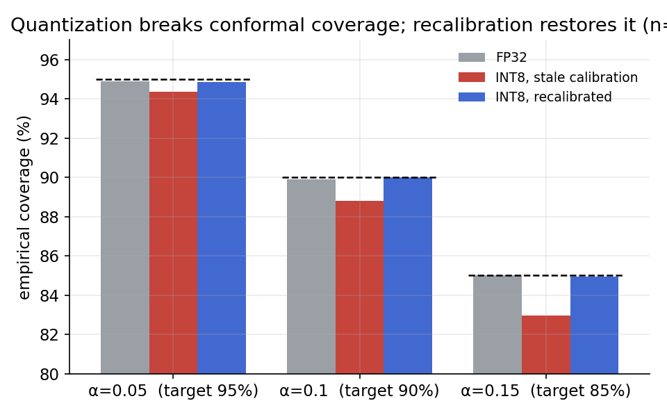
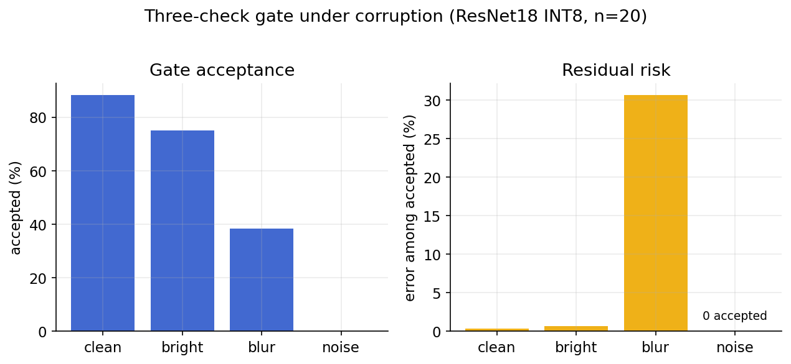
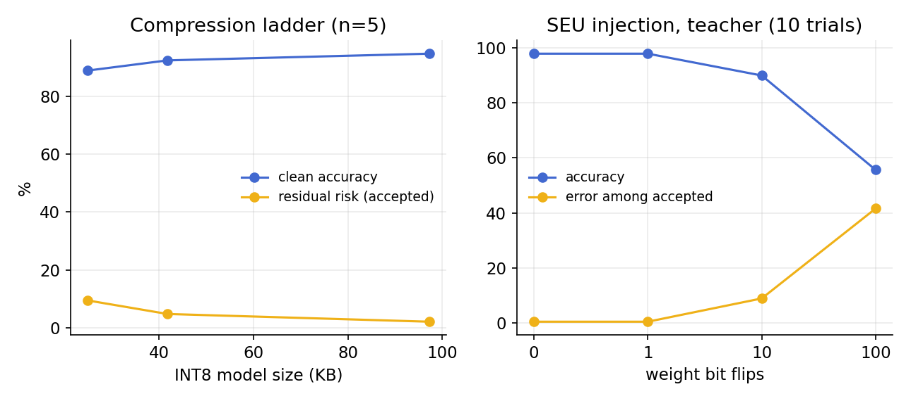
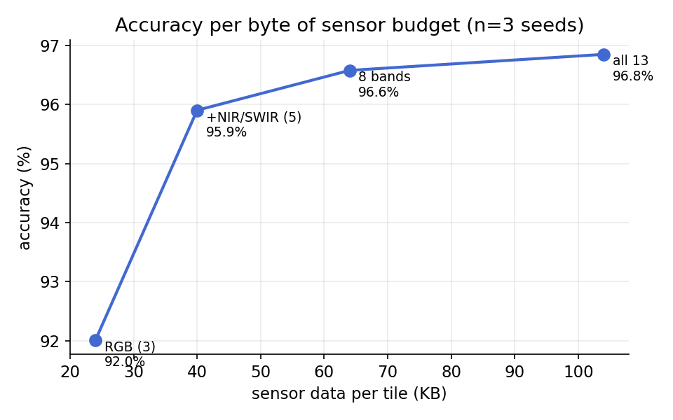
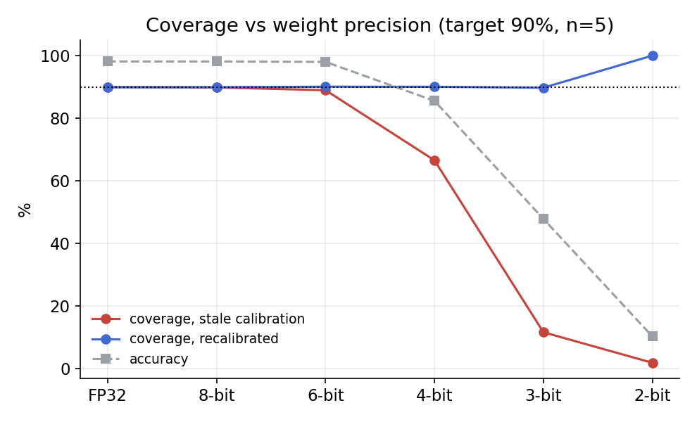
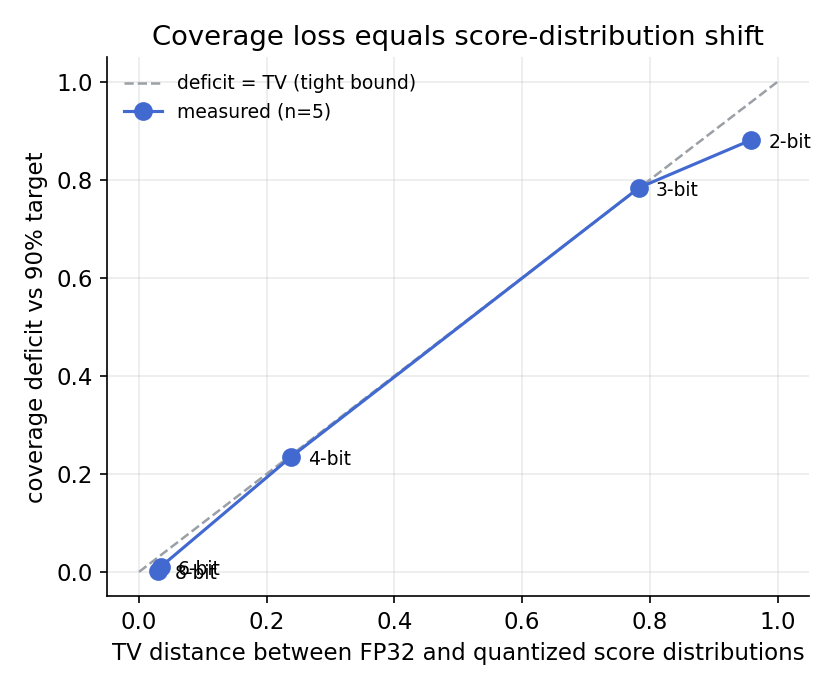

# EuroSAT Land Cover: from coursework CNN to an assured onboard EO stack

This repo started as an MSc AI for Space group project (University of Leicester, graded 90%, see `coursework/`): a ResNet-18 classifier for EuroSAT satellite imagery. I have since rebuilt it into a measured research project: an onboard-class EO classifier with layered assurance (calibrated refusal, out-of-distribution monitoring, compression/assurance trade-offs, and radiation-fault behaviour), built as the perception front end for a formally verified action-gating kernel (separate project). Everything below is measured. The scripts in `experiments/` and the raw outputs in `results/` reproduce all of it (single RTX 5090, EuroSAT RGB, fixed splits and seeds).

Nine findings, in the order I found them:

## 1. Quantization silently breaks conformal guarantees (n=20 seeds)
If you calibrate split conformal prediction on the FP32 model and reuse that calibration on the INT8 deployment artifact, coverage falls below target at every alpha tested (for example 88.8% +/- 0.8 against a 90% target, widening to a 2-point gap at alpha 0.15). INT8 itself costs almost no accuracy (98.13% to 98.03%). Recalibrating on the quantized model restores target coverage. The practical rule: calibrate the artifact that flies, not the model you trained.

## 2. Conformal refusal misses sensor noise entirely (n=20)
Refusal (an empty prediction set) rises as expected under blur (49%) and brightness shift (39%). Under additive Gaussian noise the model instead becomes confidently wrong: accuracy 13%, refusal 6.9%, which is below the clean-image rate. The coverage guarantee fails without any visible signal.

## 3. Energy-score OOD misses the same noise (n=5)
At a 5% clean false-positive budget, energy-score detection catches blur (45%) and brightness (34%) but only 1.5% of noise. Noise inflates the logits, so a logit-space score reads it as more in-distribution, not less. Two independent learned monitors share the same blind spot.

## 4. A near-free input-statistics check closes the gap (n=20)
An envelope over two raw-image statistics, high-frequency energy and per-channel standard deviation (one 3x3 average pool and two reductions, cheap enough for a microcontroller), catches 100% of noisy inputs in 20 out of 20 seeds at 1.7% clean cost. With the three checks combined (conformal, energy, input statistics) the ResNet18 INT8 pipeline shows clean residual risk of 0.32% +/- 0.11 at 88.3% acceptance, zero noisy inputs accepted, and 0.65% residual under brightness shift. Each layer catches failures the others miss.

## 5. Tightening the blur threshold reduces exposure, not conditional risk (n=20)
Sweeping the envelope's lower bound flags between 12% and 40% of blurred inputs, but the error rate among accepted blurred inputs stays flat at roughly 27 to 31% at every operating point. Mildly blurred in-envelope images are genuinely ambiguous. Input-space filtering reduces how much blur gets through; it does not make the accepted remainder safer. Reported as a curve and stated as a limitation.

## 6. Compression has an assurance price; bit flips have no output-side alarm
Ladder (n=5): distilled students at 99.5 KB, 42.8 KB and 25.4 KB INT8 hold 94.8%, 92.5% and 89.0% accuracy with residual risk 2.1%, 4.7% and 9.4%. Noise blocking stays at 100% at every size because the input-space check does not depend on the model. That is a 450x size reduction with the assurance cost measured rather than assumed.
SEU study (10 trials per level): single weight bit flips have no measurable effect; at 100 flips the teacher falls to 55.6% accuracy while the gate still accepts 76.6% of inputs, 41.6% of them wrong. Output-side monitoring cannot detect weight corruption. Memory integrity protection (weight digests, EDAC) is a separate and necessary layer, and is what the downstream verified kernel's self-integrity check provides.

## 7. Multispectral: the gate transfers, and five bands buy most of the value (n=3)
Re-running the stack on the full 13-band Sentinel-2 EuroSAT (uint16 TIFs, 2 GB): conformal coverage lands on target (90.06% vs 90%), clean residual risk is 0.70% at 88.1% acceptance for the small model, and the input-statistics check again blocks 100% of noisy inputs. Band-selection curve (same small CNN, bytes = per-tile sensor data): RGB-3 92.0% at 24.6 KB; RGB+NIR+SWIR (5 bands) 95.9% at 41 KB; 8 bands 96.6% at 65.5 KB; all 13 bands 96.8% at 106.5 KB. Five bands capture about 97% of the 13-band accuracy at 38% of the data budget, and the marginal value of a band collapses after 8. Spectral choice matters more than model capacity at this scale: the 5-band small model beats the RGB one by 4 points.


## Figures






## 8. The quantization-coverage scaling law (n=5)
Sweeping weight precision from FP32 down to 2 bits with per-channel post-training quantization: coverage under stale FP32 calibration collapses smoothly and monotonically with the quantization-induced probability shift (89.8% at 8-bit, 88.9% at 6-bit, 66.5% at 4-bit, 11.6% at 3-bit, 1.9% at 2-bit against a 90% target), tracking the relative weight perturbation (1%, 4%, 20%, 42%, 75%). Recalibrating on the quantized model restores target coverage at every precision, including a 3-bit model that is only 47.8% accurate (coverage 89.7%) and a 2-bit model at 10.3% accuracy (coverage 100%, achieved by prediction sets growing toward all classes). The split is exact: validity is always recoverable by recalibration; what degrades irreversibly is efficiency, the informativeness of the sets. Stale calibration fails silently and predictably; the probability shift is measurable on the ground before flight, which makes the coverage loss forecastable.



## 9. Coverage loss under quantization equals the score-distribution shift (n=5)
Testing the non-exchangeable conformal bound (Barber et al. 2023: coverage cannot fall below the target minus the total-variation distance between calibration and test score distributions) against the stage-8 sweep: in the damage regime the bound is tight, not just satisfied. At 4-bit the measured coverage deficit is 0.235 against a TV distance of 0.238; at 3-bit, 0.784 against 0.783. At 8 and 6 bits the bound is loose (deficit 0.002 and 0.011 against TV 0.030 and 0.034). The one nominal violation (0.001 at 3-bit) is within histogram-estimator error. Practical consequence: TV distance is computable on the ground from the labeled calibration set before deployment, so the coverage loss a quantized model will suffer under stale calibration is forecastable in advance to within a few tenths of a percent in the regime where it matters.



## Architecture this feeds
```
raw image .. input-stats envelope ..\
INT8 classifier .. conformal sets ...+-- ACCEPT/REFUSE --> formally verified action-gating
              \... energy score ..../                      kernel (machine-checked proofs,
                                                           cFS-integrated; separate project)
```

## Notes
- Toolchain: quantization-aware training gained nothing over post-training quantization at this scale (95.75% vs 95.78%). PTQ suffices, which simplifies any qualification story.
- Prior art: weighted conformal prediction for onboard EO domain shift exists (DLR, SPIE 2025) and is the foundation for the perception layer here. The contribution of this repo is the systems integration, the measured failure modes, and the qualification framing (ECSS-E-HB-40-02A), not new conformal methodology.
- Next: on-silicon latency for the 25 to 100 KB students on an STM32/WB55 alongside the kernel's WCET harness; an end-to-end cFS demo; real rather than synthetic sensor-degradation data.

## Repo map
- `coursework/`: the original module project (report, slides, notebook, demo video; graded 90%)
- `experiments/eurosat_stage1..9.py`: one self-contained script per stage
- `results/*.json`: raw measured outputs (per-seed rows and aggregates) behind every number above

MSc AI for Business Intelligence, University of Leicester. Experiments August 2026.
